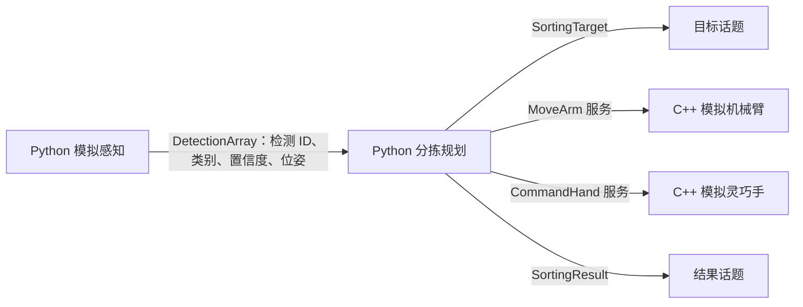

# 机械臂与灵巧手蔬果分拣流水线

基于 **Ubuntu 22.04 / ROS 2 Humble / Python 3.10 / C++17** 的最小可运行项目。
目前仅实现软件模拟：不需要相机、机器人模型或设备驱动，不会连接真实硬件。
模拟对象为苹果、番茄和黄瓜；检测、分类及位姿都是确定性测试数据，不代表真实识别或物理抓取能力。

**流水线主线**已增加独立演示：苹果、香蕉、梨子、西红柿模型随逻辑输送带移动，进入抓取区后停带、模拟分拣并恢复输送。
最终交付步骤、当前进度和需要的现场配合见 [完成计划](docs/delivery-plan.md)。真实输送带目前只能人工调速/暂停，程序接口尚未确认；自动启停演示全部使用模拟接口。

已确认现场硬件为 **AUBO K5 + 睿研智控 RY-H1 标准版（16 自由度）+ Intel RealSense L515**，用户已有基于 ROS 2 Humble 的静止抓取流程。
设备规格和接入顺序见 [硬件清单](docs/hardware.md)。已检查上传的静止抓取程序，现行入口为 `demo3_autograsp.py` 任务 1；[检查报告](docs/legacy-grasp-review.md)记录了复用边界和待修问题。
本仓库已加入可离线测试的 CAN 报文编码模块；现场 SDK、模型和原抓取脚本尚未接入运行流程。

## 项目结构与架构

```text
fruit_sorting_ws/
└── src/
    ├── fruit_sorting_interfaces/   # ament_cmake：5 个消息、4 个服务
    ├── fruit_sorting_perception/   # 固定场景/移动输送带模拟检测
    ├── fruit_sorting_planning/     # 分拣与输送协调状态机 + C++ 模拟机械臂/手
    └── fruit_sorting_bringup/      # launch、YAML 参数、端到端测试
scripts/
├── install_dependencies.sh        # Ubuntu/Humble 检查与 rosdep 安装流程
└── build_and_test.sh              # 与 CI 共用的构建、测试入口
.github/workflows/ros2-humble.yml
docs/
├── delivery-plan.md               # 最终交付步骤、现场配合与验收要求
├── hardware.md                    # 用户提供的硬件规格与待确认接入信息
├── interfaces.md                  # 接口、状态与错误处理契约
├── integration-roadmap.md         # MoveIt 2、Gazebo、相机及硬件接入评估
├── legacy-grasp-review.md         # 现有抓取程序检查与迁移问题
├── legacy-source-inventory.json   # 上传文件指纹及静态依赖清单
└── validation.md                  # 当前实例的验证记录及限制
```

仓库原有的 `src/fruit_sorting_bringup` 入门示例和 `scripts/codex_cloud_setup.sh` 已保留。
开发与 CI 使用新的 `fruit_sorting_ws`；旧 `src/` 下的 `COLCON_IGNORE` 避免同名功能包被重复发现。



默认流程：置信度 ≥ 0.8 且类别已配置 → 生成分拣目标 → 模拟机械臂移动到取物位姿 → 模拟手闭合 → 模拟机械臂移动到对应类别的投放位姿 → 模拟手张开 → 发布结果。
一帧包含 5 个检测：3 个有效类别、1 个未知类别和 1 个低置信度对象，因此每次启动只执行 **3 个目标**。
每秒重复发布相同检测 ID，用于验证去重，而不会无限重复抓取。

## 依赖与安装

基础依赖包括 `rclpy`、`rclcpp`、`geometry_msgs`、`std_msgs`、`rosidl`、`ament_cmake_python`、`pytest` 和 `launch_testing`。
包依赖均写在各自的 `package.xml` 中；不需要 CUDA、MoveIt 2 或 Gazebo。

### Ubuntu 22.04 原生环境

先按 [ROS 2 Humble 官方安装文档](https://docs.ros.org/en/humble/Installation/Ubuntu-Install-Debs.html) 安装 ROS。
在当前仓库根目录运行：

```bash
./scripts/install_dependencies.sh
./scripts/build_and_test.sh
```

安装脚本检查 Ubuntu 22.04 和 Humble，按需安装 rosdep/colcon，更新 rosdep 数据并执行：

```bash
rosdep install --from-paths fruit_sorting_ws/src --ignore-src --rosdistro humble -y
```

依赖已满足时不会重复更新 apt 索引；有缺失依赖时正常更新索引并安装。
脚本不关闭 TLS、包签名或证书校验。

### Debian 等非兼容宿主机：使用 Ubuntu/Humble 容器

不要把 Ubuntu ROS deb 包安装到不兼容宿主机。以下命令在仓库根目录执行，镜像固定到已验证的官方摘要：

```bash
docker run --rm -it --network host \
  -e ROS_LOCALHOST_ONLY=1 \
  -v "$PWD:/workspace/fruit-sorting-ros2" \
  -w /workspace/fruit-sorting-ros2 \
  ros:humble-ros-base-jammy@sha256:566b87e6dfc48392189a9c32e594e84060fa9948de93b04e536f39475a1f6963 \
  bash

# 以下命令在该容器中执行
./scripts/install_dependencies.sh
./scripts/build_and_test.sh
```

无交互终端时去掉 `-t`。官方镜像的入口会加载 Humble；手动 `docker exec` 进入容器时请先 `source /opt/ros/humble/setup.bash`。
容器内默认 root，生成的构建文件在 Linux 宿主机上也可能归 root 所有；源码仍可由宿主机编辑，构建输出已通过 `.gitignore` 排除。

在带 HTTPS 检查代理的云环境中，需要将代理变量和平台信任的 CA 带入容器：增加 `-e HTTP_PROXY -e HTTPS_PROXY -e NO_PROXY -e http_proxy -e https_proxy -e no_proxy`；必要时只读挂载宿主机信任包，例如 `-v /etc/ssl/certs/ca-certificates.crt:/run/host-ca.crt:ro -e SSL_CERT_FILE=/run/host-ca.crt -e REQUESTS_CA_BUNDLE=/run/host-ca.crt`。不要关闭证书验证。
Docker 镜像拉取需要 Docker Hub；rosdep 需要 `raw.githubusercontent.com`，安装缺失 apt 包需要 Ubuntu 软件源及 `packages.ros.org`。
若代理拒绝某个软件源，应在云环境网络设置中允许该域名，不能将拒绝访问误当成包签名失效。

## 编译与运行

### 流水线模拟（当前主线）

完成构建后在 Ubuntu/Humble 终端运行：

```bash
source /opt/ros/humble/setup.bash
cd fruit_sorting_ws
source install/setup.bash
ros2 launch fruit_sorting_bringup conveyor_demo.launch.py
```

可在另一个已加载工作空间的终端观察：

```bash
ros2 topic echo /conveyor/cycle_results --qos-durability transient_local
ros2 topic echo /conveyor/state --qos-durability transient_local
```

预期四个不同目标依次完成 `completed`，完整循环包括停止和恢复输送；演示只生成一批四件对象，全部完成后不再生成来料。
模拟坐标、带速、间距和料框位置是软件夹具，不是现场配置；本演示没有真实图像识别、物理抓取或设备连接。
源码中的队列服务会明确确认目标已接收，避免仅发布一次话题造成启动时漏接任务。

故障验收示例（每次运行独立启动一个实例）：

```bash
ros2 launch fruit_sorting_bringup conveyor_demo.launch.py fail_stop:=true
ros2 launch fruit_sorting_bringup conveyor_demo.launch.py hand_fail_command:=close
ros2 launch fruit_sorting_bringup conveyor_demo.launch.py fail_start:=true
```

失败后协调器锁定，不会继续派发下一目标；抓取失败不自动恢复输送。错误清除和现场恢复尚需真实设备反馈与操作流程，当前 mock 演示可结束进程后重新启动。

### 原固定场景演示

分步编译（也可直接运行上述 `build_and_test.sh`）：

```bash
source /opt/ros/humble/setup.bash
cd fruit_sorting_ws
colcon build --symlink-install --executor sequential \
  --cmake-args -DCMAKE_BUILD_TYPE=RelWithDebInfo
source install/setup.bash
ros2 launch fruit_sorting_bringup demo.launch.py
```

预期日志出现 `sort-apple-001`、`sort-tomato-001`、`sort-cucumber-001` 的 `completed`。
在另一个加载了同一工作空间的终端检查接口：

```bash
ros2 topic echo /sorting/results --qos-durability transient_local
ros2 topic echo /sorting/targets --qos-durability transient_local
ros2 interface show fruit_sorting_interfaces/srv/MoveArm
```

目标和结果话题保留有界的 transient-local 历史，因此晚加入的订阅者也能看到结果。
同一网络中运行多个开发项目时，为各自终端设置相同且独立的 `ROS_DOMAIN_ID`；本项目 CI 使用 42。
`Ctrl+C` 结束演示。再次启动会重置本次运行的去重状态。

故障注入示例（仍然只调用模拟节点）：

```bash
ros2 launch fruit_sorting_bringup demo.launch.py arm_fail_phase:=place
ros2 launch fruit_sorting_bringup demo.launch.py hand_fail_command:=close
ros2 launch fruit_sorting_bringup demo.launch.py namespace:=line_a
```

默认参数见 `fruit_sorting_bringup/config/`。坐标以米为单位，`mock_table` 是测试坐标系。
投放坐标仅是软件测试夹具，不是机器人工作空间、运动学、标定或碰撞参数。
当前模拟机械臂只接受 `mock_table`，不支持通过修改参数来宣称实现坐标变换。

## 测试与 CI

```bash
./scripts/build_and_test.sh

# 已构建后，仅执行测试
source /opt/ros/humble/setup.bash
cd fruit_sorting_ws
source install/setup.bash
colcon test --executor sequential --event-handlers console_direct+ \
  --return-code-on-test-failure
colcon test-result --verbose
```

- 感知单元测试：检测 ID 唯一、数据有效、筛选样本完整。
- 规划单元测试：类别映射、阈值边界、未知类、非法位姿/置信度/配置、模拟响应门控。
- 离线 CAN 编码测试：原脚本报文的字节顺序、字段边界、非法输入拒绝；测试不打开总线、不发送帧。
- 流水线测试：移动目标进入抓取区、停带后新鲜数据确认、四类分拣循环，以及停带/手部/恢复输送故障锁定。检查样本过期、未来时间戳和停带前旧帧不会被授权。
- 启动集成测试：实际启动 Python 和 C++ 节点，验证 3 类目标、去重和命名空间隔离；验证请求顺序、服务拒绝、非模拟响应、服务不可用及响应超时；检查所有启动进程正常退出。

GitHub Actions 在 `ubuntu-22.04` runner 上使用相同的固定 Ubuntu/Humble 镜像，运行相同安装、构建和测试脚本，并上传测试结果。
仓库推送至 GitHub 后，push/PR 自动触发，也支持手动触发。当前云端容器的本地测试通过不等于 GitHub 远端工作流已经运行。

## 当前边界与后续开发

当前实现是事件/服务流水线验证，没有真实视觉模型、TF 变换、碰撞检测、运动轨迹、抓取力控或流水线输送带跟踪。
每次运行最多接收 `max_targets` 个不同的有效检测 ID，默认 100；完成或失败的 ID 在本次进程中不自动重试。目标失败会停止该目标的剩余步骤，模拟流程随后可处理队列中的下一目标。
服务超时仅停止软件后续步骤，不能撤销已发送的请求；不能用于保证真实机器人停止。

下一步接入评估与必要接口见 [integration-roadmap.md](docs/integration-roadmap.md)。在 URDF/SRDF、控制器、限位、碰撞场景、抓取约束和安全验证齐备前，不应将演示服务替换成实体运动接口。

源码、接口、参数、文档和 CI 均位于此 Git 仓库；构建产物、日志和 Python 缓存已忽略。初始仓库维护者邮箱是占位值，发布前应替换为实际维护者信息。
