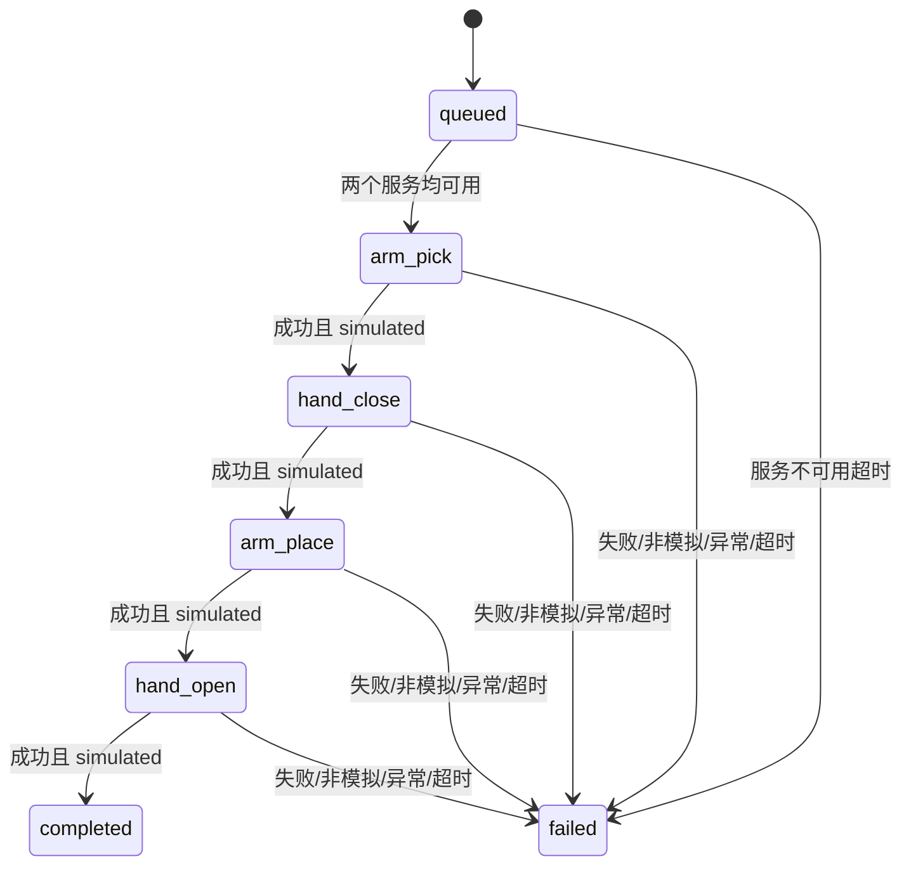

# 接口与执行契约

名称均为相对名称，支持 launch 的 `namespace` 参数。下表省略命名空间前缀。

| 话题/服务 | 类型 | 用途 |
| --- | --- | --- |
| `perception/detections` | `DetectionArray` | 每帧检测列表，检测中包含类别识别结果 |
| `sorting/targets` | `SortingTarget` | 接受的对象及取放位姿，可供可视化和审计 |
| `sorting/results` | `SortingResult` | 每个已接受目标的最终成功或失败状态 |
| `arm/move` | `MoveArm` | 模拟移动到取物或投放位姿 |
| `hand/command` | `CommandHand` | 模拟闭合或张开灵巧手 |

## 数据契约

- `ProduceDetection`：`detection_id` 必须非空且代表稳定的对象身份；`class_label` 为识别类别；`confidence` 有限且位于 [0, 1]；`PoseStamped` 包含位置、单位四元数及坐标系。
- `DetectionArray.header` 标注帧来源和采集时间；每个检测的 `pose.header` 是该位姿的权威坐标系信息。当前规划按检测自己的 header 校验，不做 TF 或时间同步。
- `SortingTarget.target_id` 在此版本中为 `sort-<detection_id>`；沿用检测的取物位姿，按类别配置生成投放位置。`detection_id` 便于追溯。
- `SortingResult` 含时间戳、`target_id`、`success`、`simulated`、最终 `stage` 及说明。`simulated=true` 表示该结果来自此软件模拟流水线，不能作为实物动作完成证据；失败结果也遵循此语义。

默认类别为 `apple`、`tomato`、`cucumber`，类别与投放位置由参数提供。未知类和低置信度对象直接过滤，不生成目标结果。非法检测被拒绝并记录日志。
未支持坐标系会被拒绝，不隐式假设相机坐标等于机器人坐标。
检测话题使用 reliable/volatile，深度 10；目标和结果使用 reliable/transient_local，深度为 `max_targets`。

## 控制契约与状态

`MoveArm` 请求包含 `target_id`、`phase`（`pick` 或 `place`）和 `target_pose`。
`CommandHand` 请求包含 `target_id`、`command`（`close` 或 `open`）和 `class_label`。
两个服务响应均为 `success`、`simulated`、`message`。
模拟服务只进行输入校验和故障注入，返回成功不表示完成碰撞检测或物理执行。

`stage` 为 `arm_pick`、`hand_close`、`arm_place`、`hand_open` 或 `completed`。失败结果保留失败阶段。
状态机一次仅处理一个目标，异步等待服务，不在订阅回调里阻塞。
`service_timeout` 使用单调时钟，既覆盖等待服务也覆盖响应等待。超时或失败后不发送当前目标的下一请求，不自动重试或发出松手等补偿动作。
取消客户端 future 不会取消服务端已经开始的操作；未来真实执行必须改用可取消、可确认停止的动作协议。

去重集合对已接受的 ID 生效，大小受 `max_targets` 限制；达到上限后不再接收新目标。去重不跨进程重启，ID 生命周期、持久化和过期策略留待引入真实跟踪器后设计。
当前不处理检测新鲜度、移动输送带时序或持续更新的目标位姿。
